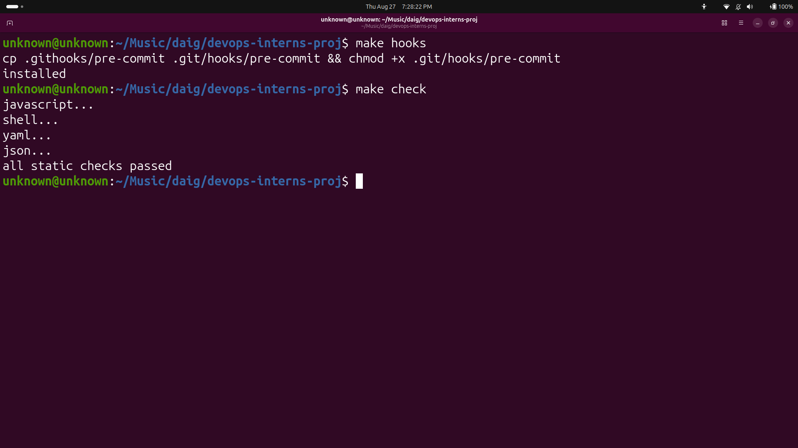

# Phase 0 — Baseline Verification

## Objective

The purpose of this phase was to verify the initial state of the Daig project before starting the practical tasks. I installed the repository Git hooks and ran the project's static validation checks to confirm that the available source code and configuration files pass the baseline checks.

## 1. Install Git Hooks

I ran the following command:

    make hooks

Output:

    cp .githooks/pre-commit .git/hooks/pre-commit && chmod +x .git/hooks/pre-commit
    installed

The Git pre-commit hook was successfully installed. This hook helps maintain code quality by running configured checks before a commit is created.

## 2. Run Static Checks

I ran the following command:

    make check

The output showed:

    javascript...
    shell...
    yaml...
    json...
    all static checks passed

The project successfully passed its available static checks for JavaScript, shell scripts, YAML files, and JSON files.

## 3. Evidence

Screenshot of the successful baseline checks:

## 4. Verification Status

According to `VERIFICATION.md`, there is an important difference between static verification and real verification.

### VERIFIED (static)

Static verification means that a tool checks whether code or configuration files are valid, correctly formatted, or syntactically correct. However, the complete application or infrastructure is not necessarily executed.

For example, JavaScript files can pass `node --check`, YAML files can be successfully parsed, and shell scripts can pass syntax checks without proving that the complete application works at runtime.

### VERIFIED (real)

Real verification means that a component was actually executed and its output or behaviour was inspected.

For example, successfully building a Docker image, starting the complete application stack, or running an integration test that successfully places a real order are examples of real verification.

### UNVERIFIED

Unverified means that the code or configuration exists but has not yet been executed or tested with the actual required environment.

This does not automatically mean that the component is incorrect. It means there is currently no execution evidence proving that it works.

## 5. Why the Difference Matters

A configuration can look correct and pass static validation while still failing during actual execution because of missing dependencies, incorrect runtime configuration, networking problems, version incompatibilities, unavailable services, or other environment-specific issues.

For this reason, "the code looks correct" and "the system was executed successfully" are different engineering claims. Static checks provide an early level of confidence, while real execution provides stronger evidence that the system actually works.

Keeping an honest record of what has been statically checked, actually executed, and not yet verified is important for reliable DevOps and production engineering.

## Phase 0 Result

- Git hooks were successfully installed.
- The project's static checks were executed.
- JavaScript, shell, YAML, and JSON checks passed.
- `VERIFICATION.md` was reviewed.
- The difference between static verification, real verification, and unverified components was understood.

**Final Result: Phase 0 baseline verification completed successfully.**
